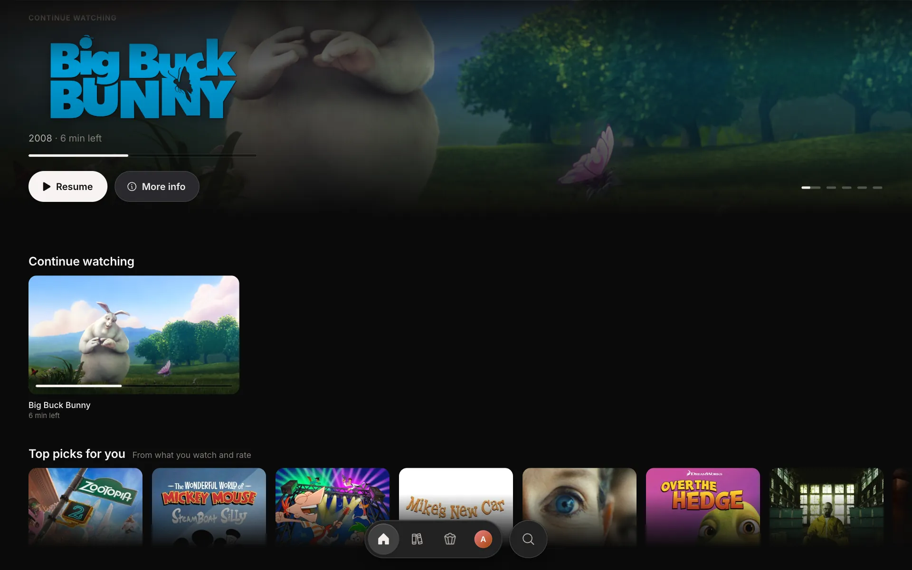
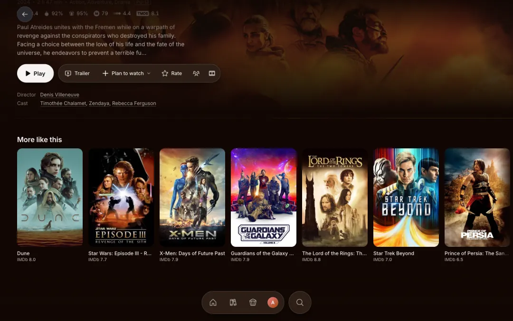

# Krida

Krida is a free, open-source streaming app in the spirit of Stremio and Nuvio. You sign in, bring your own TMDB key,
a debrid service and Stremio addons, search any film, show or anime, and press Play. It plays in the browser, or you
start a party and watch with friends in sync, with a shared queue, chat and reactions.

Krida hosts no files. Your addons find streams, your debrid service fetches them, and Krida plays them.

Try it at https://krida-open.vercel.app.



| A title | The player | A party |
| --- | --- | --- |
|  |  |  |

## What it does

- One account holds up to 8 profiles, each with its own history, Plan to watch, ratings, picks and addons, and an
  optional PIN.
- Title pages show scores from IMDb, Rotten Tomatoes, Metacritic and Letterboxd (through MDBList), the cast, every
  episode and the trailer.
- The player skips intros and recaps, remembers subtitles, shows a picture as you scrub (TorBox only) and goes on to
  the next episode.
- Parties work across accounts: the host shares a link, and anyone signed in who opens it joins.
- Every catalog your addons offer can be a row on Home. You can rename, reorder, hide or pin each one.
- Apps: the web app installs as a PWA on phones, and there are apps for Android and for Mac (Windows is coming). The
  downloads are on the [releases page](https://github.com/kausthubh-coder/krida-open-releases/releases/latest).

## What you bring

Krida asks for these during setup and checks each key with its provider when you paste it. Keys belong to your
account; only your own sessions can read them.

| Key | Needed for | Where to get one |
| --- | --- | --- |
| TMDB API key (required) | Titles, search, rows, artwork | [themoviedb.org](https://www.themoviedb.org/settings/api), free |
| A debrid service | Playing anything | TorBox, Real-Debrid, AllDebrid, Premiumize, Debrid-Link, Offcloud or EasyDebrid |
| MDBList API key (optional) | Scores from IMDb, Rotten Tomatoes, Metacritic and Letterboxd | [mdblist.com](https://mdblist.com/preferences/), free |

TorBox is the one that does the most. It turns files into a stream any browser can play, so playing in the browser,
parties and the timeline's pictures need it. Other services play every file in the desktop app (mpv) or in an
external player, and in the browser only when the file is a format the browser plays.

Streams come from Stremio addons, per profile. Setup offers Torrentio, Comet and TorBox's own addon configured with
your debrid key, or you can paste any addon's link or bring your addons over from a Stremio account.

## Run your own

Krida runs on [Convex](https://convex.dev) (database, sync and the stream pipeline), [Clerk](https://clerk.com)
(sign-in) and [Vercel](https://vercel.com) (the site and the `/api` functions). All three have free plans that are
enough for a small group.

### On your computer

```sh
npm install
npm run setup     # .env.local, a local Convex backend with two QA profiles, a free port
npm run dev       # this checkout on its own port and its own local backend
npm run doctor    # what's missing, if anything looks off
```

Sign in at `http://localhost:<port>/qa` as `Worktree-QA-one` (its password is in `.krida.local/worktree.json`). QA sign-in needs no Clerk and
works only on a local or dev backend. `npm test` runs the unit and backend tests, and `npm run check` runs everything
CI runs.

### Your own deployment

1. Fork this repo.
2. Create a Convex project with a dev and a production deployment.
3. Create a Clerk application with email codes (and Google, if you want it), and a JWT template named `convex`.
4. Point the code at your deployments. These names are written in the code, not read from the environment:
   - `convex/auth.config.ts`: your Clerk instance's domain.
   - `convex/lib/deployment.ts`, `server/session.ts`, `src/data/backend.ts` and `scripts/vercel-build.mjs`: your
     production Convex deployment's name (and in `scripts/vercel-build.mjs`, your preview deploy key's prefix).
   - `src/features/settings/QaSignIn.tsx` and `scripts/vercel-build.mjs`: your dev deployment's name.
   - The site's address (`krida-open.vercel.app`) in `convex/legacy.ts`, the Simkl redirect in `convex/lib/simkl.ts`
     and `src/features/settings/ConnectSimkl.tsx`, and the apps in `desktop/` and `android/`.
5. Create a Vercel project from the fork (`vercel.json` sets its build command) with these environment variables:
   - `CONVEX_DEPLOY_KEY`: your production deploy key (Production only).
   - `VITE_CLERK_PUBLISHABLE_KEY`: your Clerk publishable key.
   - Optional: `SIMKL_CLIENT_ID` to offer Simkl sync, `VITE_TORBOX_REFERRAL` for a TorBox sign-up link,
     `VITE_POSTHOG_KEY` and `POSTHOG_KEY` to send errors and timings to your own PostHog project. Without them those
     parts stay off.
6. Push to `main`. Vercel runs the tests, deploys Convex, then builds the site.

`AGENTS.md` maps the code and lists the commands and rules; `docs/architecture.md` explains what runs where and how a
stream starts; `docs/ops.md` covers deploys and secrets.

## Credits

This product uses the TMDB API but is not endorsed or certified by TMDB. Metadata also comes from Cinemeta and Kitsu,
and scores from MDBList. Krida plays through hls.js in the browser and mpv in the desktop app.

## License

[GPL-3.0](LICENSE), like Nuvio.
